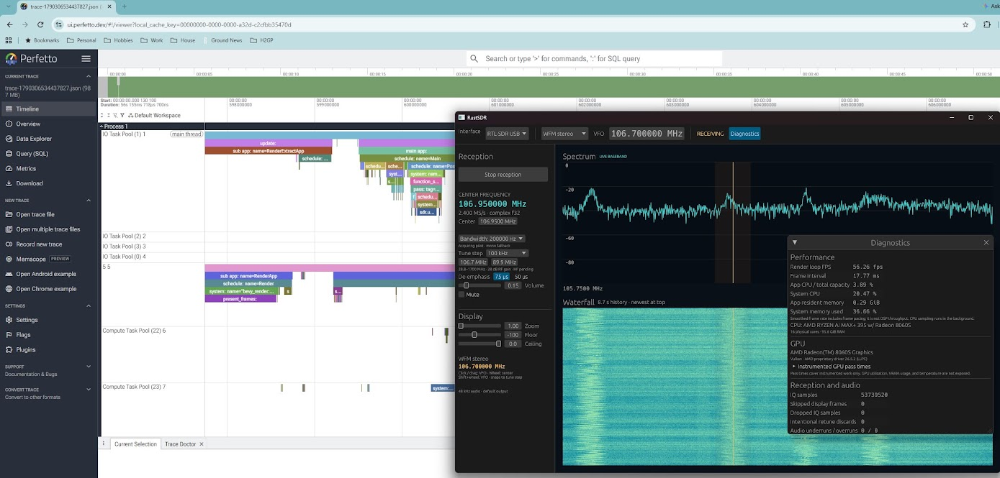
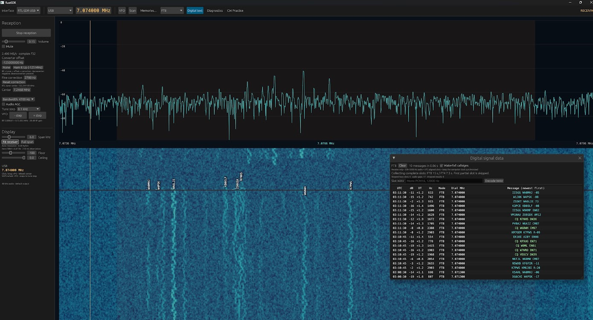
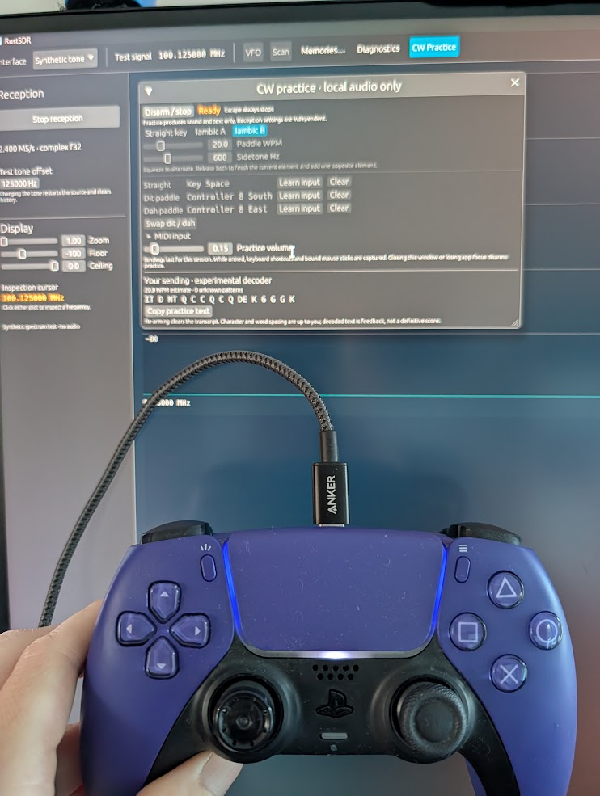

# RustSDR
A modular SDR platform written in the Bevy Game Engine, with a focus on high performance and Rust-centric portability.

## Disclaimers ##
This is an entirely experimental project with no expectation of support. 
This was an idea I've had for a long time, building an SDR with a game engine due to the toolkit's strong points for doing detailed tracing and handling many things happening on screen. 
This project is entirely done by agents and is not intended for production use.




## Digital Decoding ##
**FT8 / FT4 decoding** is available in the header's decoder selector, with automatic USB/6 kHz display setup, a background decoder, a separate message window, compact Waterfall/Text tabs and offline reference WAV import. See [setup, library selection and tests](docs/ft-decoding.md). JS8 and transmit encoding remain follow-ups.

Digital results use a compact newest-first table, with optional vertical callsigns
that move with the waterfall. A separate **Fine correction** in the RTL controls
supports precise converter calibration; see [frequency correction](docs/frequency-converters.md#fine-calibration).

Broadcast FM data is available through **Signal Data** in the header: RDS/RBDS station name, RadioText, PI, numeric PTY and traffic flags. Decoding works in WFM mono or stereo, including while muted. Try 89.9 MHz with the connected RTL-SDR. See [FM broadcast data](docs/fm-broadcast-data.md) for usage, tests and current limits.

A Rust software-defined radio application with GPU-rendered spectrum and waterfall displays and an architecture that accommodates future transmitter and transceiver integration.





## Project status

QMX USB reception is available in the desktop app with CAT VFO/mode control, discovered bands, explicit monitor routing, and audio spectrum/waterfall. See [QMX reception setup](docs/qmx-reception.md) and [hardware measurements/backend research](docs/qmx-integration.md).

Early implementation. The four-crate Cargo workspace has synthetic, IQ file, and live RTL-SDR sources, bounded reusable buffers, FFT analysis, a Bevy spectrum/waterfall frontend, and WFM mono/stereo, AM, NFM, USB, LSB, and CW audio. The immediate implementation scope is reception; transmit processing and equipment control are future milestones. RDS/RBDS and an experimental Morse decoder are available through Signal Data.

These documents are for contributors and future development sessions. After reading them, a contributor should be able to start the first milestone without reconstructing the original conversation.

## Direction

- Write application logic, DSP, and rendering integration in Rust. Native libraries, manufacturer SDKs, and external tools are allowed behind adapters.
- Use Bevy as the initial rendering choice, with egui for controls and custom GPU rendering for spectrum and waterfall presentation. Validate this choice in the first milestone.
- Keep the radio core independent of the rendering engine and frame rate.
- Model receive streaming, transmit streaming, and radio control as separate capabilities coordinated by a device session.
- Implement a useful single receiver before adding multiple receivers or transmission.

Windows is the initial development target, with portable core boundaries. This is a planning default, not a restriction on eventual platform support.

## Reading order

1. [Decisions and open questions](docs/decisions.md): requirements, defaults, and deferred choices.
2. [Architecture](docs/architecture.md): components, streaming, device contracts, and future transmission.
3. [Roadmap](docs/roadmap.md): phased outcomes and completion gates.
4. [First milestone](docs/milestone-01.md): concrete implementation sequence and validation.
5. [Receiver modes and decoders](docs/receiver-modes.md): implemented voice modes and future decoder architecture; see also the [mode backlog](docs/mode-backlog.md).
6. [Platform and WebSDR explorations](docs/platform-explorations.md): portability assessment, potential native-server/browser-client topology, and useful near-term boundaries.

See [engine boundaries and feature composition](docs/engine-boundary.md) for the implemented portability refactor, and [before/after trace results](docs/architecture-trace-comparison.md) for its regression check.

## Memories and scanning

Open **Memories…** to store and recall named frequency/mode groups, import/export CSV files, or run memory and stepped VFO scans. In Memory mode, the wheel over either plot and Left/Right arrows recall entries. Scans pause for a configurable fixed time above a channel-power threshold; **Stop scan · stay here** holds the current channel.

See [memory/scan instructions and CSV columns](docs/memories-and-scanning.md) and the [sample FM group](docs/examples/broadcast-fm.csv). Use **Save** to persist edits across launches.

## CW listening and text

Select **CW** for a narrow channel with a 600 Hz listening tone. **Signal Data** provides an experimental adaptive Morse decoder, threshold and spacing controls, and copyable text. Recent decoded text appears above the spectrum. See [CW usage, library research, and reproducible fixture](docs/cw-decoding.md).

**CW Practice** in the header adds local straight-key and iambic A/B practice, with paddle WPM, sidetone pitch/volume, and text feedback. Defaults: Space for straight key, Z/X for dit/dah. Use **Learn input** to bind keyboard, mouse, controller buttons, or MIDI notes/CC; **Arm practice** starts input capture and Escape stops it. No radio is needed and no RF is transmitted. See [practice and MIDI setup](docs/cw-practice.md).

## Build and run

Requires Rust 1.93 or newer and a working native linker (on Windows, the MSVC toolchain and Windows SDK). Verified with Rust 1.93.1 on Windows. First builds require network access to download dependencies; subsequent builds can use `--offline`. The GUI also requires a supported graphics adapter/driver.

```powershell
cargo run -p sdr-app --features desktop -- --gui
```

The GUI displays a synthetic tone at 100.125 MHz in a 2.4 MHz capture centered on 100 MHz. Start/stop and test-tone changes run on a controller worker. Span and level sliders affect the display; clicking either plot moves an inspection cursor, not a receiver VFO. Changing the source clears history. The waterfall retains 256 analysis rows at their original frequency coverage; time per row depends on resolution. Use **Fit receiver** or **Span kHz** for automatic narrowband resolution; see [spectrum resolution](docs/spectrum-resolution.md). Skipped display rows appear as dark red gaps.

The headless CLI remains available without the GUI feature:

```powershell
cargo run -p sdr-app --release
cargo run -p sdr-app --release -- --blocks 4096 --tone-hz -125000
cargo run -p sdr-app -- --help
```

The CLI generates a complex tone, measures its frequency and mean power, and stops after the requested number of blocks. Defaults: 256 blocks of 4096 samples, 2.4 MS/s nominal sample rate, +125 kHz offset from a 100 MHz center, and amplitude 0.5. Expected mean power is 0.25. Processing is unpaced: reported throughput is a headless diagnostic, not a live-radio benchmark. The fixed pool holds four sample buffers (128 KiB of sample storage).

```powershell
cargo test --workspace --all-features --offline
cargo fmt --all -- --check
cargo clippy --workspace --all-targets --all-features --offline -- -D warnings
cargo build -p sdr-app --features desktop --offline
cargo run -p sdr-app --features desktop --offline -- --gui --smoke-test
```

The smoke test opens a temporary window, exercises stop/start, cursor interaction and resizing, saves a screenshot in the build output directory, and exits automatically. It requires a graphical desktop.

Next are device/audio recovery checks and longer reception/performance validation. See the [implementation status](docs/implementation-status.md) for evidence, limitations, and the continuation point.

## Listen with the RTL-SDR v3

From the repository root:

```powershell
cargo run -p sdr-app --features desktop -- --gui --rtl
```

Starts at **106.7 MHz**. Use the **89.9 MHz** preset to try the other suggested station. The station field accepts 28.8–1700 MHz in normal RTL tuner mode; clicking either plot tunes reception. Volume starts at 15%; mute and volume do not restart the radio. Audio uses the default output device. Close other programs using the dongle first.

The receiver uses 2.4 MS/s input, fixed 28 dB tuner gain, a nominal 200 kHz FM channel, and 48 kHz stereo-frame audio (equal channels in mono modes). Select 75 or 50 microseconds of de-emphasis as appropriate; the default is 75. Capture initially centers 250 kHz above the station. VFO tuning within 1 MHz of capture center keeps acquisition, audio output, and waterfall history running. Selecting a station outside that usable span moves capture center to station plus 250 kHz. Hardware retunes keep the dongle open, briefly restart USB reads, and preserve history at its original RF frequencies.

A matching **64-bit** native runtime and working WinUSB driver are required. The supplied DLL is 32-bit and is preserved. A compatible runtime is installed separately under `third-party/rtl-sdr-blog-v1.4.0/runtime/x64/`. See [native runtime setup and provenance](third-party/README.md) to reproduce this setup or override the library path. Synthetic mode does not need the DLL.

Hardware diagnostics (these open the dongle; the second also plays audio):

```powershell
cargo run -p sdr-devices --example rtl_probe -- 106700000
cargo run -p sdr-app --features audio --example live_probe -- 89900000
cargo run -p sdr-app --features desktop -- --gui --rtl --smoke-test
```

The live GUI smoke test stops/restarts, selects 89.9 MHz, clicks the waterfall, scrolls center frequency, verifies retained capture/history, resizes, saves `target/rtl-smoke.png`, and exits after approximately 15 seconds. It requires the radio and a graphical desktop. The development profile optimizes DSP/device crates for live processing; use a release build for performance evaluation.

## Tuning controls

- **Click or drag** on spectrum/waterfall: tune the VFO, snapped to the selected step.
- **Wheel up/down** over either plot: shift capture center and VFO together by the step, preserving their relative offset.
- **Shift+wheel**: move only the VFO. For file playback, ordinary wheel also moves only the VFO because capture center is fixed by the recording.
- **Tune step**: select 1, 5, 10, 25, 50, 100, 200, or 1000 kHz (default 100 kHz).
- **Center** field: directly adjust live capture center, carrying the VFO with it. The station field still allows exact frequency entry.

An amber band shows the nominal 200 kHz receive channel. Waterfall rows retain their original capture frequency, so panning reprojects history instead of clearing it. Dark red areas indicate missing samples/display rows or frequencies outside an older row's captured span. Stop/start and source changes still clear history.

In-band VFO tuning avoids a hardware gap. Center retunes briefly silence audio while USB acquisition changes frequency; the UI reports intentionally discarded samples separately as **Retune discards**. A short development-machine probe measured about 23 ms to the next spectrum after a VFO change and 188–215 ms for center changes. These are not speaker-latency guarantees. A bounded audio queue discards old-station samples on tuning and uses approximately 40 ms prefill with a short fade-in.

Repeat the live timing check with `cargo run -p sdr-app --features audio --example tuning_probe`.

## Play an IQ recording

Supported input is headerless **interleaved float32 little-endian I/Q** (`I0,Q0,I1,Q1,...`), exactly **2,400,000 complex samples/s**. Enter the original capture center explicitly; it cannot be inferred from raw samples. All seven listening modes are supported. The selected carrier must be within 1 MHz of capture center, from 1 Hz to 1700 MHz. Byte IQ, WAV, SigMF, and other sample rates are not supported yet.

Generate a two-second recording of a 1 kHz FM test tone, then play it without a dongle:

```powershell
cargo run -p sdr-devices --example fm_fixture -- target/fm-demo.cf32
cargo run -p sdr-app --features desktop -- --gui --file target/fm-demo.cf32 --center-hz 106950000 --sample-rate 2400000
```

The generator refuses to overwrite an existing file. Its output is 38.4 MB, centered on 106.95 MHz with the FM signal at 106.7 MHz. Playback initially selects capture center minus 250 kHz, clamped to the supported file-frequency range.

Alternatively select **IQ file** in the GUI, paste a path, enter its capture center in MHz, choose the station, and press **Start reception**. File metadata edits stop playback. VFO, mode, bandwidth, and de-emphasis changes during playback retain the file position and waterfall. Stop/start restarts from the beginning. There is no pause, seek, or looping yet. File controls scroll vertically in smaller windows.

Playback follows sample time with fixed-size buffers. EOF drains queued audio, shows **END OF FILE**, and retains the last spectrum/waterfall; press Start to replay. Empty files, incomplete I/Q pairs, nonfinite samples, and unsupported metadata report a recoverable fault. An incomplete final FFT window is omitted, while its IQ samples still pass through the selected demodulator. Recordings shorter than 4096 samples do not produce a spectrum.

Add `--smoke-test` to the playback command to exercise stop/start, EOF, and resizing and save `target/file-smoke.png`. The smoke fixture must be long enough to deliver spectrum rows before its scripted stop (the generated two-second recording meets this requirement).

## Listening modes

For frame/thread timelines, see [Perfetto trace capture](docs/profiling.md). Build with `--features perfetto`, set `TRACE_CHROME` to a JSON output path, reproduce a short scenario, and close normally before opening the file in Perfetto.

The top bar contains interface selection, demodulation mode, and an editable VFO frequency. Reception controls and mode-specific settings remain in the sidebar. **Diagnostics** in the top bar (or **F12**) opens an optional resizable window with render-loop FPS/frame interval, app/system CPU, resident memory, GPU adapter/backend information, available instrumented GPU pass timings, and the radio/audio counters. Reception/audio faults remain visible when the window is closed. CPU percentages are normalized to total machine capacity; GPU timings cover instrumented passes, not total GPU utilization. GPU utilization, VRAM usage, and temperature are unavailable in this implementation.

User validation: a 30-minute manual multi-mode stability test is complete; most modes were validated, with live AM still outstanding. The next proposed increment is [modular receiver controls and broadcast-FM services](docs/receiver-panels.md), including RDS/RBDS station text and a separate HD Radio feasibility study.

Select **WFM mono**, **WFM stereo**, **AM**, **NFM**, **USB**, **LSB**, or **CW** above the tuning controls. Changing modes retains the source, file position, audio endpoint, and waterfall; receiver filters reset and old audio is discarded with a short fade-in. Switching modes restores the settings and tuning step for that mode. GUI settings are automatically saved between launches in the OS user configuration directory; see [settings and session restoration](docs/settings.md).

| Mode | Controls |
| --- | --- |
| WFM mono/stereo | 200 kHz RF filter; 50/75 μs de-emphasis; stereo pilot status and automatic mono fallback |
| AM | 6/10/12 kHz full RF bandwidth; audio AGC |
| NFM | 12.5/25 kHz RF bandwidth; 2.5/5 kHz deviation; Off/300/750 μs de-emphasis; optional power squelch in dBFS |
| USB/LSB | 1.8/2.4/2.7 kHz bandwidth starting 300 Hz from the carrier; audio AGC; 100 Hz default tuning step |

Bandwidth, tuning step, and NFM deviation are independent. The amber overlay depicts the nominal selected passband, including its side for SSB. Squelch uses uncalibrated digital channel power, not dBm. The initial AGC is a simple audio envelope controller; advanced RF AGC, noise reduction, and noise blanking remain future work.

Launch directly into stereo reception:

```powershell
cargo run -p sdr-app --features desktop -- --gui --rtl --mode stereo
```

Live frequency policy is currently **28.8–1700 MHz**, device 0, 28 dB gain, and 2.4 MS/s. Actual coverage depends on the tuner. V3 HF direct sampling is **not enabled**; HF AM/SSB can be exercised through IQ recordings. An appropriate antenna and adapter support are still needed for live HF.

Generate a stereo listening fixture (1 kHz left, 2 kHz right), or substitute `am`, `nfm`, `usb`, `lsb`, or `wfm` in both commands:

```powershell
cargo run -p sdr-app --example voice_fixture -- stereo target/stereo-demo.cf32
cargo run -p sdr-app --features desktop -- --gui --file target/stereo-demo.cf32 --center-hz 106950000 --sample-rate 2400000 --mode stereo
```

The generator creates two seconds of IQ and refuses to overwrite existing files. Stereo separation requires a stereo output device; a mono endpoint receives the average of left and right. See [receiver design](docs/receiver-modes.md) and the [future mode backlog](docs/mode-backlog.md) for decoder plans.


External up/downconverters: see [frequency converter setup](docs/frequency-converters.md), including the Ham It Up preset for HF reception.

VOR prototype, independent decoder subscriptions, recorded FM/RDS regression tests and future hardware/DAB options: see [decoder extensions](docs/decoder-extensions.md).

Rust is the default RTL-SDR backend; the desktop interface selector also offers librtlsdr as a fallback. Explicitly saved backend choices are preserved. See [backend comparison and test instructions](docs/rtl-backends.md).

IC-705 USB audio, CI-V tuning and the initial bounded transmit-tone test: see [IC-705 setup and validation](docs/ic705.md).
