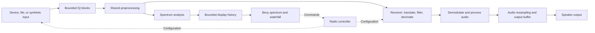

# Architecture

Audience: contributors implementing radio services or presentation. This document defines ownership and behavior; exact Rust traits should be established through the first working implementation.

## Component boundaries

Start with four logical crates:

| Crate | Owns | Must not depend on |
| --- | --- | --- |
| `sdr-core` | Domain types, capability contracts, device/session lifecycle, commands and reported state | Bevy, egui, manufacturer SDKs |
| `sdr-dsp` | Sample-block processing, filters, resampling, demodulation, spectrum analysis | UI or device libraries |
| `sdr-devices` | Synthetic/file inputs, hardware adapters, device audio and transport integration | UI widgets |
| `sdr-app` | Native engine orchestration, monitor output, composition, Bevy presentation, user controls, settings | Internal details of particular driver implementations |

Shared data contracts belong in the core. Adapters and DSP depend on those contracts; the application wires implementations together. Keep runtime scheduling small and concrete; extract another crate only when there is a clear ownership need.

Future platform direction: preserve an in-process desktop engine while allowing a later native service to feed browser presentation. Near-term work should isolate native features, runtime scheduling, controller commands/state, monitor audio, and decoder outputs. No network protocol or universal executor is selected. See [platform and WebSDR explorations](platform-explorations.md) for the assessment and scope boundaries.

Implemented local ownership and feature details are documented in [engine boundary](engine-boundary.md). The Bevy draw systems now use a client handle; the composition root retains engine lifetime ownership.

## Receive pipeline



A VFO is an independently tuned receiver channel inside the captured spectrum. Hardware center frequency and VFO frequency are distinct. Multiple VFOs initially share one device's sample rate and captured band; their usable filter bandwidths must fit inside that band. Define a deliberate retune policy before supporting multiple VFOs.

Normalize input IQ to complex float32 at the adapter boundary initially. Each block carries a sample count, stream identity, configuration generation, sample index, and discontinuity indication. Sample rate and center frequency must be available unambiguously through block metadata or its immutable stream description. Distinguish hardware timestamps from software-derived sample positions.

Increment the configuration generation when a retune, rate change, restart, or file seek invalidates queued data. Reset affected DSP state and prevent stale results from being displayed under new frequency labels. Absolute tuning values should retain adequate precision, using integer Hz initially; oscillator phase and fractional frequency calculations can use floating point.

## Execution and flow control

- Device acquisition, DSP, and audio run independently of rendering. Start with a small number of workers that process multiple stages per block.
- Use bounded queues and reusable buffers. Choose queue capacities in units of time as well as samples so their latency cost is visible.
- A spectrum consumer must never block reception. Drop display updates on overflow, count them, and mark gaps in waterfall time rather than silently stretching history.
- Live input generally cannot be paused indefinitely. Record IQ overflows and discontinuities and reset affected state; do not grow queues to hide overload. File playback can be paced and backpressured.
- The audio callback reads prepared samples from a bounded buffer. It performs no DSP, file I/O, device commands, allocation, or blocking waits. Underruns output silence and increment a counter.
- Audio and radio clocks can drift. Track audio-buffer occupancy and provide a resampling correction strategy before claiming sustained live playback.
- Recording uses its own bounded path. Report recording loss or stop recording explicitly on overflow; never let disk stalls silently stall the receiver.

Send typed commands to the controller and return acknowledged results plus device state. Coalesce frequent tuning gestures when appropriate. Expose requested and reported values separately when operations are asynchronous or quantized by hardware. Apply changes at defined stream boundaries; avoid UI-held locks on processing state.

Shutdown must cancel blocked reads, stop acquisition, terminate workers, stop audio, and release the device. Repeated start/stop and partial initialization failures are supported lifecycle cases.

## Device and control contracts

Model a device session with optional interfaces, rather than a universal device required to implement every operation.

| Capability | Contract |
| --- | --- |
| Discovery | Stable identity where available, transport, descriptive information |
| Receive streaming | Supported formats/rates, stream lifecycle, IQ blocks, errors and discontinuities |
| Transmit streaming, future | Accepted formats/rates, output lifecycle, queue/underrun reporting |
| Radio control | Query/set supported tuning and operating parameters; asynchronous results and externally changed state |
| Resource coordination | Shared clocks, local oscillators, antennas, rate restrictions, half/full-duplex combinations |

Capability descriptors must express valid combinations, not just isolated minimum/maximum values. A device session owns transport handles and serializes operations that affect shared resources. Unsupported capabilities return an explicit unsupported result and do not appear as working UI controls.

Keep discovery and adapters independent of panel rendering. Device-specific controls can be built from reported capabilities, with specialized panels later if necessary.

## Transmit and transceiver provisions

Transmission is designed for, but not implemented in receive milestones. Validate the conceptual contracts against three device profiles:

1. A receive-only IQ device: receive streaming and tuning, no transmit capability.
2. An IQ transceiver: receive and transmit streams with device-specific duplex and shared-clock constraints.
3. A conventional transceiver: control over serial/network plus independently selected audio input/output; it may provide no IQ stream.

Future signal paths:

```text
Microphone / audio file -> audio processing -> modulation -> TX IQ -> SDR transmitter
Microphone / audio file -> audio processing -> radio audio output -> conventional radio
                                                         Radio control -> PTT
```

Represent RX and TX frequencies, modes, bandwidths, and rates separately. Associate a conventional radio's control endpoint with its audio endpoints through explicit configuration. Speaker monitoring and radio output are distinct routes, never implicit copies of each other.

Reserve a transmit lifecycle: idle, preparing, transmitting, stopping, and fault. A future implementation must coordinate stream readiness with PTT, require an explicit transmit action, start/reconnect with transmit unrequested, and define timeout, underrun, disconnect, and shutdown behavior. Do not infer that PTT is off merely because the connection disappeared; show unknown state and use equipment-supported watchdogs when available.

Device limits and configurable operating restrictions belong in the controller, where future remote clients also encounter them. Detailed transmit interlocks, RF validation, and equipment-specific behavior are work for the transmit milestone. Receive work adds no operational transmit controls.

## Rendering

Use Bevy for the window, input integration, and rendering. Use egui controls initially, with deliberate input ownership so manipulating a panel does not also tune the waterfall beneath it.

The waterfall is a circular GPU texture of spectrum rows. Upload only new rows; a shader applies palette, level range, and history offset. Keep bounded history with known timing and configuration provenance. Resizing, changing FFT size, or retuning must have a defined history reset/relabel policy.

The spectrum trace consumes current power values. Define window normalization, FFT frequency ordering, averaging, and dBFS reference in the DSP implementation. Do not label uncalibrated levels as absolute RF power. Start with CPU FFTs and independent analysis/display cadences.

Shaders may use WGSL; the Rust-first requirement does not require GPU shader source to be Rust.

## Observability and persistence

Expose input rate, IQ drops, display drops, audio underruns, queue occupancy, processing time, and stream generation in a diagnostic view. Keep logging off hot callbacks; aggregate counters for reporting.

Settings should be versioned, validated, and written atomically. Recover from missing or invalid configuration with visible defaults. Persist user choices, not transient handles, pending commands, or a transmitting state.

## Decoder subscriptions (implemented)

The engine owns FT and VOR services. Independent audio readers share immutable frames. Optional IQ channels run off the capture worker with bounded queues, RF mapping, sample positions and gap resets. Initial rates are 48/240 kS/s from 2.4 MS/s capture. See [decoder extensions](decoder-extensions.md) for the API contract, prototype limits and hardware adapter roadmap.
