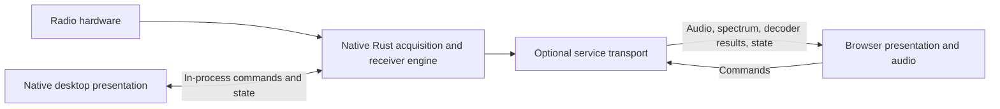

# Platform portability and a potential WebSDR

Status: future exploration, not an implementation commitment. The user expressed interest in a native radio server with a browser renderer. This document records the platform assessment and identifies architectural changes that also benefit current desktop work. Audience: contributors planning runtime and UI boundaries.

## Implemented preparation (2026-09-24)

The near-term native feature isolation, engine/client boundary, bounded output paths and modular compact controls are now implemented. Core/DSP WASM compilation is verified; Linux/macOS checks are configured but have not run. See [engine boundary](engine-boundary.md) and [trace comparison](architecture-trace-comparison.md). The platform and WebSDR experiments themselves remain deferred. The assessment below describes the starting point before that refactor.

## Evidence at the original assessment

Windows x64 is the only built and runtime-tested platform in this project so far. The development environment inspected during the assessment had only the Windows Rust target installed. Other platforms have not been cross-compiled or tested.

The core contracts and DSP are largely independent of platform I/O. The application runtime is not: it owns native threads, blocking channels/waits, filesystem inputs, and CPAL output. Device dependencies include unconditional dynamic native-library loading, with Windows DLL paths as the RTL default. Bevy and CPAL provide broader platform foundations, but their platform support does not establish application portability.

| Exploration | Assessment | Main work |
| --- | --- | --- |
| Linux/macOS desktop | Closest additional targets | Native RTL library discovery/packaging, audio/window dependencies, permissions, ARM64 builds, and actual device/lifecycle tests |
| Browser recording playback | Useful first WASM experiment | Gate native dependencies; browser file input, worker execution, audio initialization/output, rendering backend, and deployment |
| Native radio service + browser UI | Preferred WebSDR exploration | UI-independent engine, bounded transport streams, session/control ownership, reconnect semantics, browser audio and presentation |
| Direct browser RTL USB | Separate experimental path | WebUSB-compatible RTL implementation and browser/OS/device validation; current native DLL cannot be used in WASM |
| Native Android | Plausible local-radio/mobile target | USB host permissions/integration, ARM packaging, lifecycle/audio interruptions, power/thermal testing, touch controls |
| Native iPhone/iPad | Stronger initial fit for files/network radio | Platform shell, audio and lifecycle integration; direct RTL hardware access needs a separate investigation |

Web workers/audio worklets and browser APIs must replace desktop assumptions; ordinary browser WASM does not make `std::thread::spawn` or `std::fs` work. Browser background scheduling also cannot be treated as a continuous real-time acquisition guarantee. Preserve the principle that reception is independent of rendering cadence.

## Potential WebSDR topology

Retain an in-process desktop path. A network service should be another composition of the engine, not a requirement for launching the local application.

Initial server-side demodulation would let the browser receive audio, spectrum frames, and decoded messages without full-rate IQ. At 2.4 MS/s, 8-bit I/Q requires 38.4 Mb/s and float32 I/Q requires 153.6 Mb/s before transport overhead. Stereo float32 audio at 48 kHz requires 3.072 Mb/s; compression and reduced spectrum frames could lower bandwidth further. Selected channel IQ streaming can be explored later.

Start any service prototype with one trusted local/LAN client and one receiver. Public hosting is a separate scope involving authentication, resource limits, privacy, client isolation, and equipment ownership. Multiple users sharing a capture also require a policy for VFO allocation and hardware-center changes. Browser playback will need a jitter buffer, clock handling, and bounded loss/reconnect behavior. No network protocol or audio codec is selected yet.

Future TX authority remains at the hardware-owning engine; transport disconnect and command ownership must be considered before exposing PTT. This exploration adds no TX functionality.

## Changes worth making during current desktop work

| Change | Immediate benefit | Smallest useful implementation |
| --- | --- | --- |
| Gate native dependencies separately | File/DSP tests and future targets need not compile a hardware driver | Separate RTL/native audio/GUI/profiling features and appropriate target dependencies; preserve today's default launch behavior |
| Isolate engine orchestration from Bevy | Decoder workers and headless validation can share the real receiver path | Extract a concrete engine/runtime module from application composition; move to a crate only when ownership justifies it |
| Keep processing separate from scheduling | DSP correctness is testable without wall-clock sleeps | Runtime owns clocks, worker creation, pacing, cancellation, and source lifecycle; processors consume blocks and produce bounded outputs |
| Define an in-process controller boundary | UI modules stop depending on controller internals | Typed commands, acknowledged state, capabilities, and explicit receiver/source generations; retain local queues initially |
| Separate monitor audio from receiver output | Muting or losing a speaker does not disable future decoders | Prepared audio output through a concrete sink boundary; decoder taps before speaker volume/drift processing where required |
| Separate output stream semantics | A slow UI/decoder cannot stall reception or silently erase messages | Latest-value spectrum/state updates, bounded ordered decoder events, sample-timed audio, and explicit loss reporting |
| Modular, responsive controls | Complex modes and decoder results fit better today | Shared tuning controls, independent mode settings/results panels, per-mode UI state, touch-usable alternatives to wheel gestures |
| Incremental platform build checks | Catch accidental native coupling early | Core/DSP target checks first; native Linux/macOS builds and tests when runners are available; device validation remains separate |

These are incremental refactors, not a universal plugin framework. Existing `Receiver::process` already has the desired processing separation; preserve it rather than rewriting working DSP. Keep configuration validation and device lifecycle authority outside widgets. Do not let a transport or an audio endpoint become the owner of receiver state.

For the command boundary, carry request IDs/revisions and report applied state rather than assuming every UI edit immediately succeeds. Use sample positions and generation/discontinuity metadata on streams. Do not prematurely serialize existing structs or promise a stable public wire format.

## Work to defer until a prototype needs it

- A network server, transport protocol, codec, authentication implementation, and remote deployment packaging.
- A generalized async runtime or executor abstraction. Keep native threads until a browser worker implementation provides a concrete second execution model.
- Browser workers, shared-memory deployment, WebUSB drivers, and mobile platform shells.
- Public multi-user receiver allocation and shared-hardware arbitration.
- Dynamic plugins, a generic DSP graph editor, and schema-generated controls for every possible mode.

Recommended near-term order: native feature isolation; engine/client boundary and separate monitor/decoder outputs as part of decoder integration; modular panels; then desktop portability checks. The first browser experiment should use recordings. A subsequent network experiment can keep acquisition/DSP native and send audio/spectrum/results to one browser client.

## References from the assessment

- [Bevy 0.18.1 platform examples](https://github.com/bevyengine/bevy/blob/v0.18.1/examples/README.md)
- [CPAL 0.17.3](https://github.com/RustAudio/cpal/tree/v0.17.3)
- [Rust browser WASM target limitations](https://doc.rust-lang.org/rustc/platform-support/wasm32-unknown-unknown.html)
- [Web Workers](https://developer.mozilla.org/en-US/docs/Web/API/Web_Workers_API/Using_web_workers), [AudioWorklet](https://developer.mozilla.org/en-US/docs/Web/API/AudioWorklet), and [WebUSB](https://developer.mozilla.org/en-US/docs/Web/API/WebUSB_API)
- [Android USB host](https://developer.android.com/develop/connectivity/usb/host) and [Apple USBDriverKit](https://developer.apple.com/documentation/usbdriverkit)

Recheck platform/browser support when beginning an implementation; these references do not replace target builds and hardware testing.
