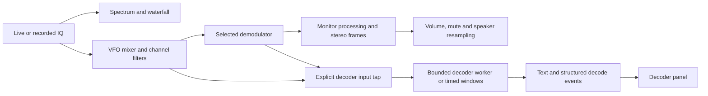

# Receiver modes and optional decoders

Latest follow-up: the user completed a 30-minute manual multi-mode stability test and validated most modes; live AM remains outstanding. The prior deferral mentioned below is historical. See [modular controls and broadcast services](receiver-panels.md) for the next proposed increment and converter mapping design.

Implementation and extension design, 2026-09-24. Audience: contributors implementing the next receiver modes. After reading, a contributor should be able to add a mode without coupling it to the RTL adapter, speaker controls, or rendering cadence.

The user requested implementation of stereo WFM, AM, NFM, and USB/LSB, with a design and backlog for CW, FT8, digital voice, and other modes. These six voice modes and CW listening are now implemented. RDS/RBDS and an initial Morse decoder are available; see [CW usage and library research](cw-decoding.md). The recent tuning UX has been user-validated. The user subsequently completed the 30-minute manual multi-mode test; instrumented stability and live AM validation remain outstanding. Receive-only scope continues.

## Modes and user experience

### Implemented baseline

WFM has forced mono and pilot-controlled stereo with smooth mono fallback, 200 kHz nominal RF width, and 50/75 μs de-emphasis. AM exposes 6/10/12 kHz RF filters and audio AGC. NFM exposes 12.5/25 kHz RF filters, independent 2.5/5 kHz deviation, optional 300/750 μs de-emphasis, and power squelch with hysteresis and 100 ms hang. USB/LSB expose 1.8/2.4/2.7 kHz passbands beginning 300 Hz from the carrier, and audio AGC. All configurations are built before replacing the active receiver. Mode changes retain capture, file position, audio endpoint, and display history; the receiver is rebuilt and old queued audio invalidated. Per-mode listening settings and tuning steps are remembered within the session.

The device policy now permits normal RTL tuning from 28.8 to 1700 MHz and file VFO frequencies from 1 Hz to 1700 MHz. This is an adapter policy, not a hardware discovery result. HF direct sampling remains unimplemented. See [mode backlog](mode-backlog.md) for the separate hardware prerequisite and proposed optional protocols. WFM multiplex and CW power taps, engine-owned RDS/CW decoders, and Signal Data are implemented. General timed-decoder workers and UTC mapping remain extension designs.

The test suite measures clean stereo fixture separation above 30 dB, USB/LSB opposite-sideband rejection above 40 dB, recovered AM/NFM tones, DC removal, silence/squelch behavior, no-pilot mono fallback, endpoint channel mapping, and exact block-boundary invariance for every mode. Controller tests exercise all mode changes without restarting the capture or rewinding playback. These checks do not establish weak-signal performance or standards conformance across arbitrary broadcasts.

Use two separate selectors: **Mode** for receiving/listening and **Decoder** for extracting text or structured messages. Offer a small set of presets, with relevant controls revealed for the selected mode. Do not put every protocol into one long demodulator menu.

| Mode or preset | Proposed controls and display | Initial work |
| --- | --- | --- |
| WFM | Mono / Auto stereo, 50/75 microsecond de-emphasis, pilot-lock indicator, stereo blend | Preserve the multiplex signal and recover independent L/R audio |
| AM | RF bandwidth, audio AGC, optional squelch | Envelope detection, carrier/DC removal, level control |
| NFM | Channel/deviation presets, squelch, optional de-emphasis | Narrow channel filtering and FM discriminator scaled for voice deviation |
| USB / LSB | Sideband, low/high audio cutoffs, AGC | Useful listening modes and a conventional digital-audio receive path |
| CW | Narrow bandwidth, tone pitch, CW/CW-reverse, optional Morse decoder | Audible carrier-to-tone conversion first; text recognition second |
| FT8 receive preset | USB receive path + FT8 decoder, audio passband, UTC slot status, decoded-message table | Timed receive windows and a replaceable decoder backend |

Starting filter choices are product defaults to verify, not claims that every service uses the same bandwidth: WFM 200 kHz nominal RF width; AM 6/10/12 kHz full RF width; NFM presets around 12.5/25 kHz channel spacing with separately specified RF filter width and 2.5/5 kHz deviation; SSB roughly 300–3000 Hz audio passband; CW 250/500/1000 Hz filters and 400–1000 Hz pitch. Channel spacing, filter bandwidth, deviation, and tuning step must remain distinct fields.

Keep the newly fluid click/drag/wheel behavior. Mode/filter changes rebuild only affected receiver stages, invalidate old audio/decoder data, and retain acquisition and waterfall history when the new passband fits. Center retuning is required only if the capture cannot contain it. The first implementation retains the conservative +/-1 MHz VFO rule for every mode. A later channelizer can replace this with mode-specific passband and transition-margin validation.

Show a truthful stereo state: pilot acquisition, stereo locked, blended toward mono, or forced mono. A pilot indicator alone is not evidence of correct stereo separation. Do not show unused WFM controls for AM/NFM or expose unavailable decoders as working features.

## Shared DSP and audio foundation

The current implementation uses `ReceiverConfig`, `Mode`, and `Receiver::process` in `sdr-dsp`. It produces 48 kHz `StereoFrame` values, carried through the audio ring and shared-phase output-rate conversion. The earlier standalone `FmReceiver` remains for compatibility and regression tests; application playback uses the multi-mode receiver.

Introduce a small typed receiver configuration: mode, VFO frequency, RF/audio filter settings, AGC/squelch settings where applicable, and mode-specific parameters. Prefer an enum of built-in receiver implementations behind a consistent processing interface; no external plugin ABI or graph editor is needed.

Not every decoder uses every tap: CW may consume narrow complex IQ or tone audio; FT8 may consume calibrated-rate USB audio or an equivalent complex baseband path; a future RDS decoder needs the WFM multiplex before the audio low-pass filter. Each decoder declares the representation and rate it accepts.

Use prepared 48 kHz stereo frames, such as `{ left, right }`, throughout the monitor queue. Mono modes produce equal L/R values. Resample both channels with the same phase/drift correction; invalidate both atomically on tuning. Output stereo to the first two output channels; define mono downmix as `(L+R)/2`, and explicitly map or silence additional channels. Keep the native audio endpoint open across mode switches. The callback still performs no demodulation, decoding, allocation, or blocking work.

Decoder input branches before speaker volume, mute, squelch gating, and output-clock drift correction. Decoder-specific gain handling must be explicit. Muting speakers must not stop decoding, and an output-device failure must not prevent decode windows from being collected. Keep decoder resampling tied to the capture timeline, not the sound-card clock.

Preserve stream identity, receiver configuration generation, sample index, nominal/estimated sample rate, RF frequency mapping, and discontinuities across each branch. Add a monotonic-to-UTC mapping with a stated uncertainty for timed decoders. An RTL-SDR software timestamp is not a hardware timestamp. A retune, mode change, source gap, or file seek invalidates affected decode windows; do not splice unrelated samples into one apparent transmission.

## Stereo WFM

Keep the demodulated FM multiplex at 240 kS/s before reducing to speaker audio. For pilot-tone stereo, the broadcast format carries the sum signal, a 19 kHz pilot, and the difference signal on a suppressed 38 kHz subcarrier. Recover pilot phase with a PLL, derive the stereo subcarrier, low-pass sum/difference with matched delays, then reconstruct L/R and apply de-emphasis per channel. See [ITU-R BS.450-4](https://www.itu.int/rec/R-REC-BS.450-4-201910-I).

Use lock hysteresis and a smooth blend toward mono when pilot confidence is poor. Preserve forced mono as a comparison and weak-signal option. Validate acquisition, phase convention, gain, and left/right assignment with independently generated multiplex fixtures. Merely duplicating mono into two output channels does not satisfy this feature. RDS is a separate later decoder, not part of the stereo acceptance gate.

## AM and narrow FM

Share frequency translation and reusable multistage decimation/filtering, but give each mode an appropriate channel rate. Do not evaluate a very long narrow filter at 2.4 MS/s when earlier decimation can reduce the workload. Measure alias rejection and adjacent-channel rejection for the actual filter chain.

Start AM with magnitude/envelope detection, DC removal, an audio low-pass filter, and bounded AGC with attack/release behavior. Keep squelch optional and off by default. Synchronous AM can be a later enhancement; carrier fades and overmodulation should not be hidden by optimistic quality claims.

NFM can reuse the phase-difference discriminator concept, with gain based on the selected deviation instead of the WFM 75 kHz constant. Add a voice filter and squelch with hysteresis/hang time so the output does not chatter around threshold. Provide de-emphasis as a mode-specific option rather than copying the broadcast-FM setting. CTCSS/DCS detection and tone squelch are later features, separate from basic voice reception.

## CW listening and Morse text

The initial implementation now has 200/500/1000 Hz filters, a fixed 600 Hz BFO, seeded adaptive timing, manual key threshold, and adjustable word spacing. Adjustable pitch and CW reverse remain deferred. See [CW details](cw-decoding.md) for the current contract, research, fixtures, and limitations; the following paragraphs describe the broader direction.

CW listening uses a narrow channel and a beat-frequency offset to render a keyed carrier as an audible tone. Display the RF carrier frequency separately from the chosen listening pitch. Changing pitch must not silently retune the station.

Add Morse text as an optional consumer of the keyed envelope: estimate key-up/key-down states and speed, segment symbols/characters/words, and emit partial text with an uncertainty indication. Start with clean machine-generated fixtures, then timing jitter, fading, interference, and manual keying. Unknown characters remain unknown; do not promise reliable text from arbitrary weak or hand-sent Morse. Timing and character references: [ITU-R M.1677-1](https://www.itu.int/rec/R-REC-M.1677-1-200910-I/).

## FT8 receive exploration

FT8 is a structured weak-signal protocol with synchronized 15-second sequences, multi-tone signaling, and error correction. It is a substantially larger decoding task than adding an FM/AM detector. Use the authors' [FT4/FT8 protocol paper](https://wsjt.sourceforge.io/FT4_FT8_QEX.pdf) as the protocol reference and [WSJT-X guide](https://wsjt.sourceforge.io/wsjtx-main_en.html) for operating/audio/time integration.

The receive UI should collect a broad audio passband and decode multiple signals per window. A message table can show UTC slot, estimated SNR, time offset, audio offset, message text, and backend. Do not imply that every decoded message contains an unambiguous callsign or grid; retain the decoded text and report only fields actually recovered. Selecting a row should inspect its signal; it must not initiate transmission.

Prototype against saved, timestamped recordings before live HF reception. Start with a fixed 12 kS/s mono decoder contract and explicitly resample for any backend with a different requirement. Bound jobs and result queues; on overload, report a skipped window instead of stalling acquisition. Include input validity and source generation in each job and result. Clock correction or a gap must invalidate/rebuild the window mapping.

Three backend approaches:

| Approach | Benefit | Tradeoff / decision |
| --- | --- | --- |
| Existing standalone decoder process | Failure isolation and quick fixture comparison | Versioned process/I/O contract, Windows packaging and cancellation need validation |
| Native decoder library through a small Rust adapter | Direct integration with the Rust pipeline | FFI ownership, support coverage, and native build become our responsibility |
| New pure-Rust decoder | Full ownership of implementation | Largest scope: synchronization, soft decisions, FEC, message unpacking, and sensitivity validation |

Recommend evaluating an existing backend first while keeping the surrounding capture/window/UI code in Rust. [ft8_lib](https://github.com/kgoba/ft8_lib) is a concrete C candidate with a file-decoding example, but its README describes an experimental implementation and incomplete message coverage. Do not assume WSJT-X-equivalent performance or a stable library API. Compare known recordings against WSJT-X before selecting a backend; record version, covered message types, build method, and dependency licenses. No decoder dependency is selected or installed by this proposal.

## Hardware coverage and frequency policy

Supported tuning ranges are now independent of mode presets. The initial normal-RTL/file policy is defined in `sdr-core` and enforced by the controller, tuning policy, and RTL adapter. A future device capability model must replace this static policy when adding tuner discovery, direct sampling, or other radios. The GUI currently presents the corresponding bounds.

Begin live AM/NFM validation in the dongle's ordinary tuner coverage and use generated recordings for deterministic coverage. HF/MW support is a separate adapter task: the RTL-SDR Blog V3 supports HF direct sampling and needs a suitable antenna. The vendor guide also notes driver-dependent automatic switching, alias images, and reduced usefulness of small VHF antennas at HF. Verify the installed runtime's behavior instead of assuming current guide behavior matches the bundled binary. See the [V3 guide](https://www.rtl-sdr.com/rtl-sdr-blog-v-3-dongles-user-guide/).

The present adapter explicitly disables direct sampling. A working AM decoder alone will therefore not establish medium-wave broadcast reception, nor will an FT8 decoder establish useful live HF reception with the current small VHF antenna. Keep these as separate software and RF validation gates. No new equipment is required to develop and test the decoders using fixtures.

## Delivery sequence and acceptance

1. **Receiver foundation:** typed mode/filter configuration, stereo audio frames, centralized device frequency ranges, reusable multirate channel processing, and decoder tap metadata. Existing WFM mono and tuning tests remain green; switching modes preserves capture/file position when possible.
2. **AM and NFM:** GUI mode selection, bandwidth presets, AGC or squelch as appropriate, and generated recordings. Verify recovered tones, level behavior, adjacent-channel rejection, squelch hysteresis, silence/invalid input, and arbitrary input block boundaries. Live tests supplement numerical tests.
3. **Stereo WFM:** pilot recovery, L/R reconstruction, forced mono and auto blend. Test left-only/right-only/different-tone channels, mono/no-pilot, pilot frequency/phase offsets, reacquisition after gaps, and stereo-to-mono output mapping. Initial clean-fixture separation target: at least 30 dB at 1 kHz, subject to a measured acceptance record.
4. **USB/LSB (implemented) and future CW listening:** sideband rejection, pitch/frequency labeling, narrow filters and tune-step presets. Keep acquisition continuous when changing receiver mode or pitch.
5. **Decoder exploration:** Morse text on clean and imperfect fixtures; FT8 backend spike with timestamped windows, multi-message results, CPU deadline checks, and a WSJT-X comparison corpus. Live FT8 follows suitable HF coverage and timing validation.

Keep changes in independently testable increments. Do not claim all of M01 complete while its stability gate is deferred, and do not attach TX/PTT actions to these receive modes. Revisit RDS, AFSK/packet/APRS, RTTY/PSK, and other decoders after the first decoder contract is proven; their requirements should determine the tap used rather than forcing all signals through speaker audio.
